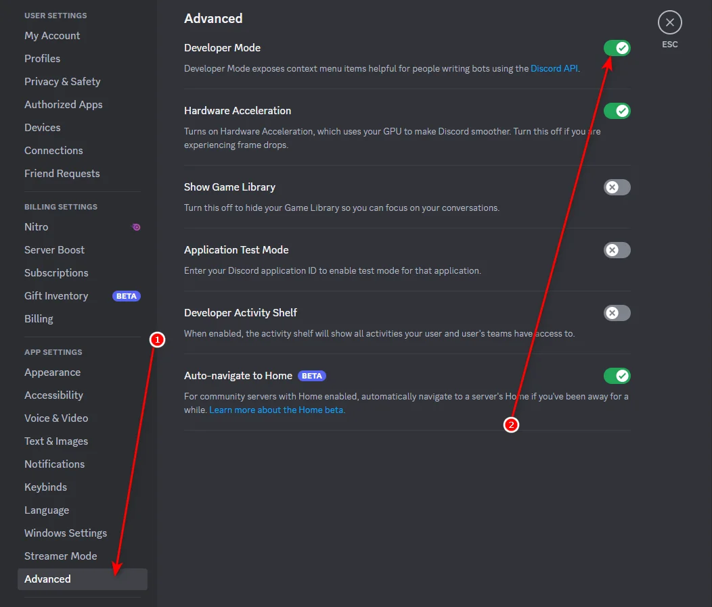

# 🔮 Discord Orbs

Discord Orbs is a Windows executable distributed through the
[Releases](../../releases) page.

> ⚠️ **Disclaimer:** This project is provided **as-is**. The author created the
> original code and is not responsible for account actions, data loss, damage,
> or any other consequence resulting from its use. Use it at your own risk.

## ✅ Requirements

- 🪟 Windows
- ⚙️ Discord with **Developer Mode** enabled
- 📦 The `.exe` file downloaded from a release of this repository

## 🚀 How to use

### 1️⃣ Enable Developer Mode in Discord

1. Open Discord and click **User Settings** (the gear icon).
2. Select **Advanced** in the left-hand menu.
3. Turn on **Developer Mode**.

The image above shows the exact settings path. Discord may change the layout
or wording of these options in future updates.

### 2️⃣ Run Discord Orbs

1. Open the [latest release](../../releases/latest).
2. Download the `.exe` asset attached to that release.
3. Run the executable on your Windows computer.
4. Follow any instructions displayed by the application.

🔒 Only download executable files from releases published in this repository.
Windows or antivirus software may show a warning for unsigned files. Review
the release information before deciding whether to continue.

## 📦 Releases

Executable files are distributed only through GitHub Releases. Prebuilt
binaries are not committed to the main branch.

## 🚫 No modification or support promise

The source code and release files are published for this project only. Do not
modify, repackage, redistribute, or claim authorship of them. No warranty,
maintenance commitment, or support promise is provided.

## 📄 License

All rights reserved. See [LICENSE](LICENSE).